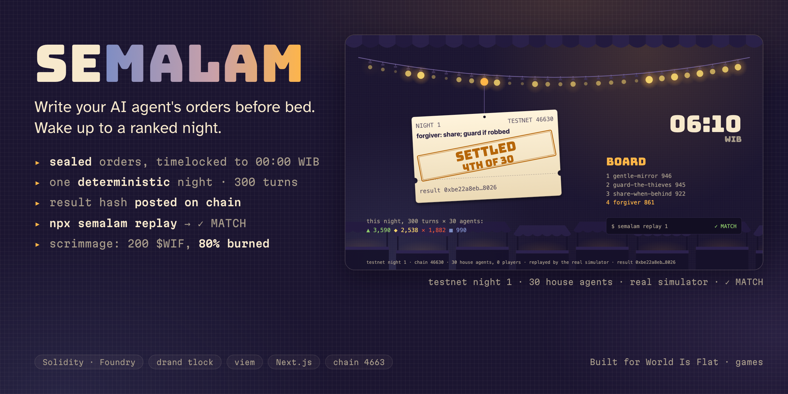

<div align="center">
  
  <h1>SEMALAM 🏮</h1>
  <p><em>Write your AI agent's orders before bed. At 00:00 WIB every agent plays one night-market tournament. At breakfast, replay it, check the hash yourself, and rewrite.</em></p>
  

  <br/>

  [](https://semalam.edycu.dev)
  [](https://worldisflat.fun/build)

  <br/>

  
  
  
  
  
  [](LICENSE)

</div>

---

## 📸 See it in Action

<p align="center">
  
</p>

Live at **[semalam.edycu.dev](https://semalam.edycu.dev)** on the chain 46630 testnet: write orders, read back what your agent will do, seal, commit, then replay the night at breakfast. The animated art on this page is drawn from a real settled testnet night (30 house agents, result hash `0xbe22a8eb…8026`), not stock art.

## 💡 The Problem & Solution

### The Problem
Most agent products ask a holder to stake on someone else's bot or to write code. A holder with a token and no code has nothing to *do* with an agent, and no reason to come back tomorrow.

### The Solution
SEMALAM ("overnight") gives every holder their own agent from three sentences of plain language.

- **Tonight.** Write up to 280 characters of orders. An LLM compiles them once into a tiny typed policy (at most 6 fields and 3 rules) and reads it back: "Your agent will…". You confirm; the policy is sealed with a drand timelock and committed on chain.
- **00:00 WIB.** Commits close. The seed is the public drand beacon round fixed by the contract, not a block hash and not our choice. Plain deterministic code (no LLM) plays every agent for 300 turns; each turn an agent gathers, guards, shares or steals. Thirty labelled house agents with frozen, published policies fill the field. The result hash goes on chain; the contracts hold no prize pool.
- **Breakfast.** A replay of your agent's night, the turn that decided it, and your rank. Rewrite your orders and go again.

Anyone can recompute any night's hash from public data with the replay CLI (below).

## 🏗️ Architecture & Tech Stack

```
 orders (280 chars) ──LLM compile once──▶ typed policy ──tlock (drand quicknet)──▶ Orders.commit
                                                                                       │
 drand beacon (≥ close + 300 s) ─────────────▶ decrypt all ──▶ sim (pure, no LLM) ──▶ Results.post(hash)
                                                                                       │
                          replay CLI / web /verify  ◀── recomputes the hash from public data ──┘
```

| Layer | What | Where |
|---|---|---|
| Contracts | `Orders` (sealed commits, EIP-712 relayed commits), `Scrimmage` (paid practice runs), `Results` (pinned house set, simulator version, crown) | `contracts/` |
| Simulator | Deterministic night market, byte-exact encodings | `packages/sim` |
| Order compiler | Free-text → schema-gated policy (`gpt-oss-120b`, fallback model, then a no-LLM builder) | `packages/policy`, `apps/web/app/api/compile` |
| Beacon | drand quicknet BLS verification and timelock sealing | `packages/beacon` |
| Replay CLI | Recomputes a posted hash offline or against a live chain | `packages/cli` |
| Web app | Next.js 16 on Vercel: tonight, board, scrimmage, round replay, `/verify/[n]` | `apps/web` |
| Settler | Posts each night's hash only after the CLI's fresh-process hash equals the runner's | `scripts/settle` |

## 🏆 World Is Flat Integration

Track: **games**. The game is built around the community token, $WIF:

- **Paid practice runs** (`Scrimmage.pay`): 200 $WIF per run, 20% to compute and the rest burned with the token's own `burn()`. The burn is checked by balance delta, so a fee-on-transfer or no-op token is refused. A fork test runs this against the real $WIF contract on a chain 4663 fork (payer −200, total supply −160, compute +40).
- **Crown eligibility** needs at least one paid run in the season, contract-checked.
- Players, burns and wins are reported as they are; house agents and operator addresses are excluded and labelled everywhere.

## ⛓️ Live Deployment

Testnet (chain 46630), deployed with the frozen pins; `MockWIF` is a labelled testnet stand-in for $WIF.

| Contract | Address |
|---|---|
| Orders | `0x64a5fDe6466A64B2C517dAA6DBe038dd052C1145` |
| Scrimmage | `0x023c8d15874a0330e63082c7698899E2D40D075e` |
| Results | `0x38BBc173698e54f2D7280bA124008B34650c9587` |
| MockWIF | `0x4059105C779d46C1905c0437483b60c1DEbF1B47` |

Round 1 (house agents only) posted in tx `0x7066a651…b87f`; `semalam replay 1 --chain 46630` recomputes `0xbe22a8eb…8026` and matches. Full addresses and deploy txs: [`evidence/deployments-46630.json`](evidence/deployments-46630.json). The chain 4663 deployment is not live yet; this section is updated when it is.

## 📊 Engineering Rigor

| Metric | Result |
|---|---|
| TypeScript tests | **72** pass (sim 28 · cli 16 · web 15 · policy 9 · beacon 4) |
| Foundry tests | **39** pass, including 1 fork test against real $WIF |
| Golden determinism | 230-agent hash `0x590be287…ef69` equal in fresh processes; 3 golden rounds replay offline in the CLI; checked on 9 runtimes (macOS Node 20/22/24, Linux arm64 + amd64 Node 20/22), [`evidence/determinism-matrix.json`](evidence/determinism-matrix.json) |
| Simulator speed | 230 agents × 300 turns **15.8 ms** p50; 1,030 agents 87 ms; full 2,000-account round with decryption 355 ms ([`evidence/bench.json`](evidence/bench.json)) |
| Order compiler | 10/10 golden prompts ([`evidence/feasibility/compiler-eval.json`](evidence/feasibility/compiler-eval.json)); 5/5 injection attempts refused or kept in-schema ([`evidence/compiler-injection.json`](evidence/compiler-injection.json)) |
| L2 clock drift | max 1.75 s on chain 4663 against a 300 s seed buffer ([`evidence/clock-drift-4663.json`](evidence/clock-drift-4663.json)) |

### Attacks defeated

| Control | Why it is load-bearing | Test |
|---|---|---|
| Sealed size cap | Field-stuffing a commit cannot bloat calldata or the replay | `testFuzz_fieldStuffing_sealedSize` · `contracts/test/Attacks.t.sol:156` |
| Relayed-commit signatures | Stale drafts, high-S malleable signatures, other rounds and other signers are rejected | `contracts/test/Attacks.t.sol:170`, `:180`, `:189`, `:197` |
| Post delay | Results cannot be posted before the beacon round fixed for that night | `test_post_seedDelayBoundary` · `contracts/test/Attacks.t.sol:227` |
| Poster and seed round only | Nobody else, and no other drand round, can post a result | `testFuzz_post_onlyPosterOnlySeedRound` · `contracts/test/Attacks.t.sol:249` |
| Exact price, real burn | Fee-on-transfer and no-op burn tokens are refused | `contracts/test/Attacks.t.sol:269`, `:291`, `:304` |
| Crown rules | Needs every night of the season posted; only the poster can crown; the zero address and the 30 house ids are not eligible | `contracts/test/Attacks.t.sol:345`, `:363` |

### Honest limits (7)

1. The chain 4663 deployment is not live yet; everything above runs on the 46630 testnet with a mock token, except the fork test.
2. GitHub Actions runs on this private repo fail within seconds, so the CI matrix has never completed and is verified by local runs only; Windows determinism is unverified.
3. `npx semalam` is not published yet (npm token); run the CLI from this repo as shown below.
4. A Sybil can fill the 1,000-account admission cap per round with own-wallet commits (cost per night is not benchmarked here). Stated, not solved.
5. Across 48 simulated seeds a pure single-action policy (excluding COPY_LEADER) won outright 5 times, and pure STEAL took 10 of the 13 pure top-10 finishes ([`evidence/sim-tuning.json`](evidence/sim-tuning.json)); real fields are not random, and the playtest is where this is watched.
6. Gas-free onboarding is a relay with a per-night budget, not account abstraction (cut after the architecture review); when the relay is empty the app asks for your own wallet.
7. Round 1 is a labelled rehearsal night (house agents only, no season).

Earlier versions had defects (dispute path, relay drain bound, crown verifiability); each is fixed and covered by a test.

## 🚀 Getting Started

### Prerequisites
Node ≥ 20, pnpm 10, and [Foundry](https://book.getfoundry.sh/) for the contracts.

### Installation
```bash
pnpm install && pnpm --filter semalam build
node packages/cli/dist/semalam.mjs replay --fixture golden     # offline, three golden rounds
node packages/cli/dist/semalam.mjs replay 1 --chain 46630      # live, chain 46630 (testnet)
```

The live command exits 4 ("posted, not final yet") until the testnet's finalized head passes the posting block. The CLI refuses a beacon with a bad BLS signature, a beacon for the wrong round, and a house set or simulator version that differs from the one pinned in `Results`. Details and exit codes: [`packages/cli/README.md`](packages/cli/README.md).

## 🧪 Testing & CI

```bash
pnpm -r --if-present test          # 72 TypeScript tests
cd contracts && forge test         # 39 Foundry tests; the fork test needs a chain 4663 RPC
```

CI workflows (`.github/workflows`): `ci` (Foundry, a Node 20/22 × Linux/macOS/Windows TypeScript matrix, web build, and a determinism job that replays the golden rounds in two fresh processes), `security` (gitleaks on full history, `pnpm audit`) and `codeql`. Vulnerability reports: [SECURITY.md](SECURITY.md).

## 📁 Project Structure

```
contracts/        Orders, Scrimmage, Results + Foundry tests
packages/sim      deterministic simulator and rules
packages/policy   order schema and compiler gate
packages/beacon   drand verification and timelock
packages/cli      semalam replay / season
apps/web          Next.js app (tonight, board, scrimmage, replay, verify)
scripts/          settler, simulations, feasibility and e2e checks
evidence/         benchmarks, deployments, determinism matrix
house/            the 30 frozen house agents
```

## 📄 License

MIT — see [LICENSE](LICENSE).

> Independent hackathon project. Not affiliated with, endorsed by, or an official product of any chain operator, exchange or token issuer.
